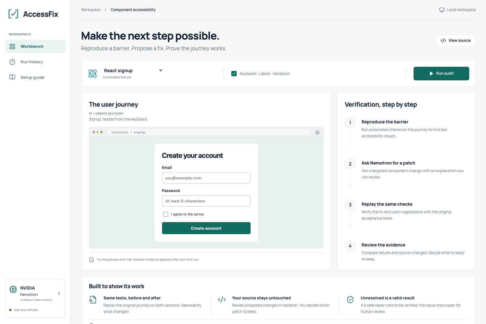

# AccessFix companion workbench

This document describes the earlier accessibility workbench retained at `/accessfix`. FirstStep is the primary project; see the [project README](../README.md).

**Reproduce accessibility barriers. Propose a repair. Verify the same user journey.**

AccessFix is a local developer tool for auditing standalone React signup, login, confirmation dialog and navigation components. It combines real Chromium interaction and axe scans with NVIDIA Nemotron on Nebius Token Factory. Model-generated changes must pass the original accessibility and behavior checks before a patch is offered for review.

Built for the [Nebius × NVIDIA Global AI Hackathon](https://nebiusglobalaihackathon.devpost.com/), **Coding and Agentic Engineering** track.



## Project status

This release is an experimental MVP with a local developer workflow and a restricted hosted judge demo. Auditing, candidate verification, regression rejection, history and report export are implemented. The latest live NVIDIA/Nebius repair improved the included signup from **6/10 to 10/10 browser checks and passed strict TypeScript checking**, with one model request. Earlier trials exposed focus, validation and typing defects; one successful fixture run does not establish general repair reliability. Prepared verification exercises are labeled separately and do not call a model. See the full [verification results](verification.md).

The current scope is four documented component contracts, not arbitrary repositories or full-application accessibility certification.

The [hosted judge demo](https://accessfix-nebius-nvidia-demo.onrender.com/accessfix) runs on Render Free. Judge credentials are shared privately. It supports fresh audits, the verification lab and recorded NVIDIA/Nebius repair evidence; new paid inference is disabled. Allow time for a cold start and download reports you need to keep. See the [deployment limits](deployment.md).

## Quick start

Install **Node.js 22+** and npm, then run:

```sh
git clone https://github.com/zainsubhani/FirstStep-Nebius-NVIDIA-Hackathon.git
cd FirstStep-Nebius-NVIDIA-Hackathon
npm ci
npm run browsers
npm run dev
```

Open [the local workbench](http://127.0.0.1:5173/accessfix). The API listens on `127.0.0.1:3001`. On Linux, install browser system dependencies with `npx playwright install --with-deps chromium`.

Audits and the verification lab work without an API key.

### Enable live model proposals

Create `.env` from `.env.example` if it does not already exist:

```sh
test -f .env || cp .env.example .env
```

Set the following values locally:

```dotenv
NEBIUS_API_KEY=your_token_factory_key
NEBIUS_BASE_URL=https://api.tokenfactory.nebius.com/v1
NEBIUS_MODEL=nvidia/nemotron-3-super-120b-a12b
```

Use the Token Factory endpoint and NVIDIA model available to your account. The backend rereads `.env` on each request; process environment variables take precedence. The key stays on the server and must not be committed. A repair sends the selected source and audit findings to Nebius and may consume paid credits. Key presence alone does not verify model access.

## Workflow

1. Select **React signup** and run an audit. Chromium reproduces label, keyboard, validation-feedback and focus failures.
2. Request a repair. Nemotron receives the source and findings and returns one bounded component proposal or abstains.
3. AccessFix requires strict TypeScript compilation and replays the unchanged browser checks against the candidate. Up to two model attempts are allowed per run.
4. Review the findings, source diff, keyboard replay, screenshots, reported token usage and elapsed time. Export an HTML report. Download a patch only when every check passes without a regression.

The original component file is never modified automatically. An accepted candidate still needs human review.

| Example | Purpose |
|---|---|
| React signup | Four reproducible accessibility failures with working validation behavior |
| Team invitation | A separate implementation with validation-feedback and focus defects |
| Working signup | A clean baseline that skips inference |
| Account login | Credential labels, error feedback and preserved credential validation |
| Confirmation dialog | Modal semantics, focus containment, Escape and safe cancellation |
| Workspace navigation | Keyboard links, current-page state and unchanged destinations |
| Verification lab | Prepared good/bad candidates and fresh verification of the recorded AI repair; no model calls |

## Command-line usage

```sh
npm run accessfix -- --fixture signup --mode audit
npm run accessfix -- --fixture signup --mode verify-regression
npm run accessfix -- --component ./path/to/Signup.tsx --mode audit
npm run accessfix -- --component ./path/to/Login.tsx --contract login --mode audit
npm run accessfix -- --fixture signup --mode verify-recorded
```

To request live inference, use `--mode repair`. Add `--max-attempts 1` to cap a run at one paid request; the default maximum is two. Custom components must follow the [component contract](component-contract.md).

Exit codes: `0` for accepted or clean; `1` for findings, unresolved/rejected candidates, cancellation or execution failure; `2` for invalid CLI configuration. A normal audit that finds defects exits with `1`.

## NVIDIA and Nebius integration

The backend calls Nebius Token Factory's chat-completions API with an NVIDIA Nemotron model. The model proposes source changes through `propose_patch` or reports `abstain`; it has no shell or filesystem tools. Playwright and axe provide independent verification. Token Factory hosts the inference, so running this local application does not require a local GPU.

The [architecture guide](architecture.md) describes the repair loop, data flow and execution boundaries. Refer to the [Nebius Nemotron example](https://nebius.com/services/token-factory/nemotron) for provider setup.

## Development and testing

```sh
npm run build
npm test
```

With the development server running in another terminal:

```sh
npm run test:ui
```

The automated suites use known or injected candidates and make no live inference calls. GitHub Actions builds the project, runs the engine and UI suites, and exercises the deployment container with 512 MB RAM and 0.1 CPU without a provider key. See [contributing](../CONTRIBUTING.md) for the development workflow.

## Documentation

| Guide | Contents |
|---|---|
| [Architecture](architecture.md) | Components, repair loop, artifacts and trust boundaries |
| [Component contract](component-contract.md) | Supported inputs and protected checks |
| [Verification](verification.md) | Automated coverage and observed live-model limitations |
| [Deployment](deployment.md) | Free Render judge demo, configuration and local production preview |
| [Demo walkthrough](accessfix-demo.md) | A reproducible demonstration using real outcomes |

## Scope and deployment

Local mode binds to loopback. The included Render Free Blueprint runs a password-protected judge demo with fixed public fixtures, shared run limits and authenticated artifacts. It restores the recorded real AI repair at startup; fresh audits and the verification lab run without inference. New paid repair requests are disabled on this ephemeral deployment. See the [deployment guide](deployment.md) for cold-start and storage limits. Local CLI artifacts may contain private source and remain in the ignored `.accessfix/` directory.

The checks cover four explicitly defined component contracts. They do not establish complete WCAG conformance, real screen-reader behavior, backend correctness or general repair accuracy.

## License

[MIT](../LICENSE). Model and hosted-provider usage remain subject to their respective terms.

## GitHub review workflow

An accepted component can be exported from the local workspace as a draft PR after reviewing its destination and diff. AccessFix checks that the GitHub file exactly matches the audited baseline and changes only that file. Shared judge demos disable repository writes. See [GitHub export](github-export.md) for authentication, supported paths and retry recovery.

## Temporary judge worker

For faster fresh browser checks, run a password-protected Mac worker with `npm run judge -- --tunnel --keep-awake`. Its launcher forces inference and repository writes off. See [judge worker setup](judge-worker.md) for private credentials, tunnel installation and availability limits.
